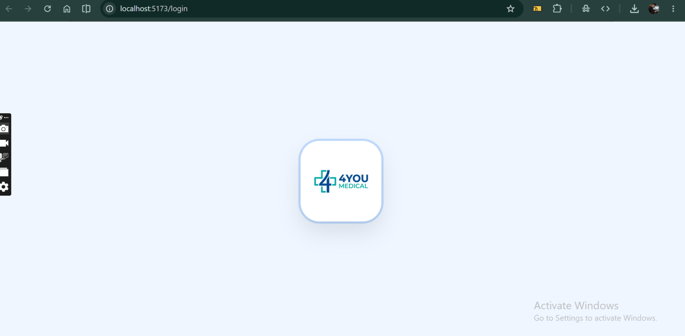
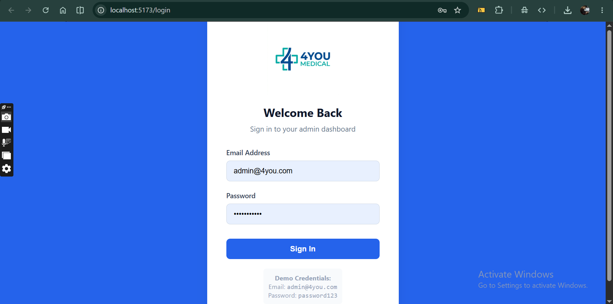
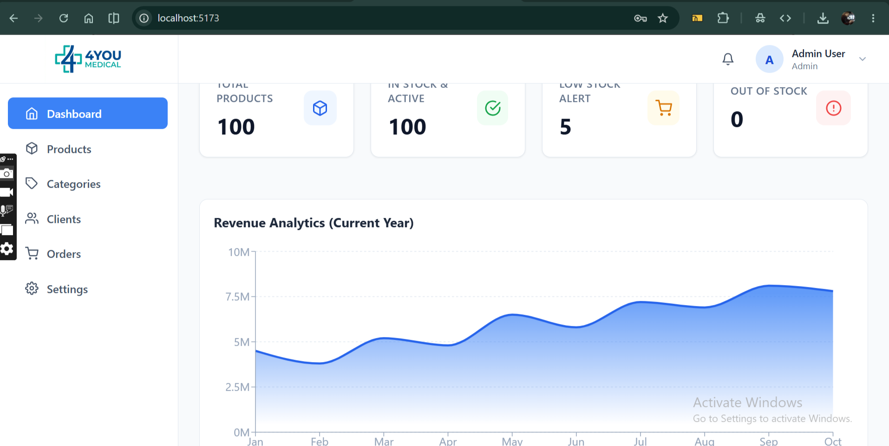
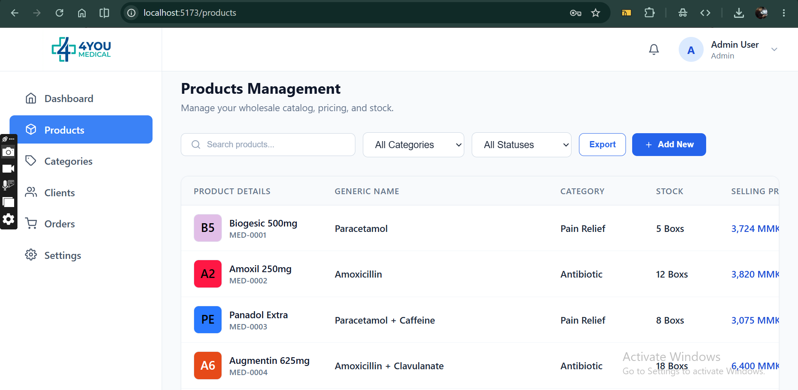
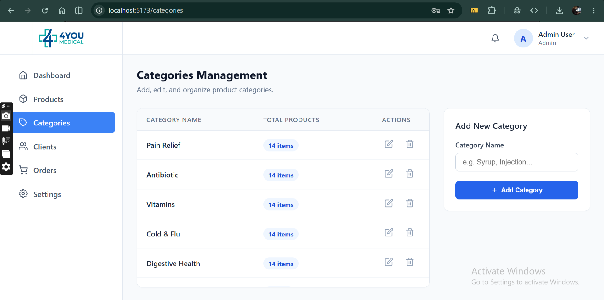
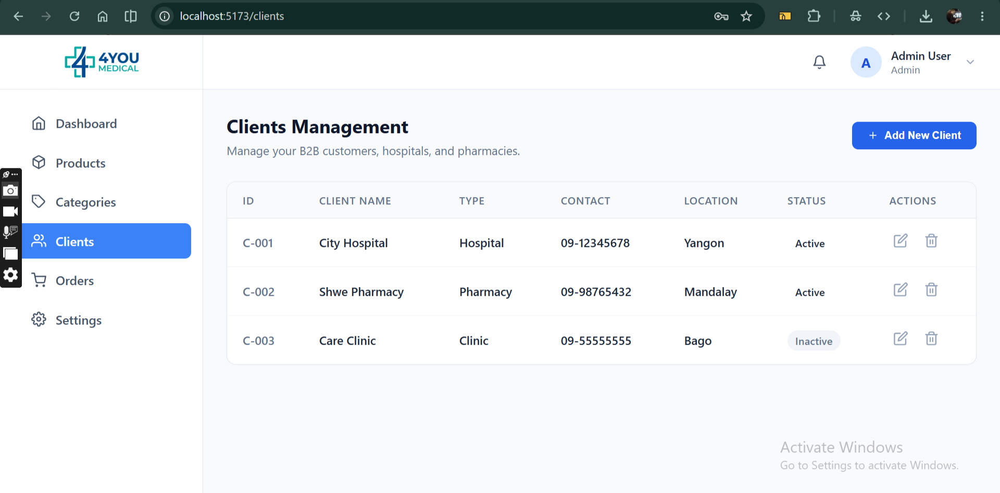
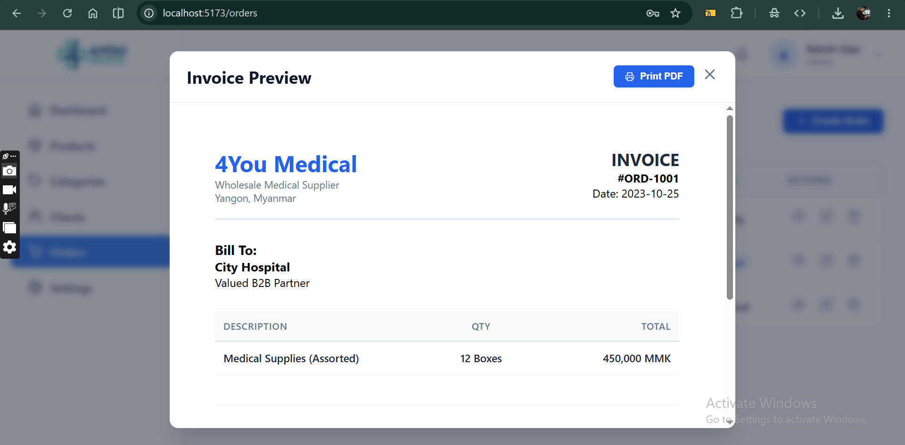
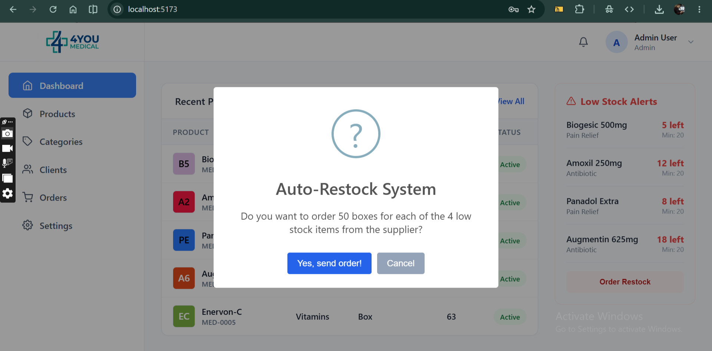

# 4You Medical - B2B Wholesale Admin Dashboard

This project is an advanced, fully responsive Admin Dashboard built for **4You Medical**, a wholesale medical supplier based in Yangon, Myanmar. 

Below is the documentation structured using the **5W1H Method** to explain the project's purpose, development journey, and technical challenges.

---

## 1. WHO (ဘယ်သူ့အတွက်လဲ / ဘယ်သူလုပ်တာလဲ)
**Target Audience (သုံးစွဲမည့်သူများ):** 
4You Medical ကုမ္ပဏီမှ Admin များနှင့် အရောင်းဝန်ထမ်း (Managers) များ အသုံးပြုရန် ရည်ရွယ်ပါသည်။
**Developers:** 
Local Environment (Windows) ပေါ်တွင် React (Vite) ကို အသုံးပြု၍ အစ်ကို (User) နှင့် ကျွန်တော် (AI Assistant) တို့ ပူးပေါင်း ရေးသားဖန်တီးထားခြင်း ဖြစ်ပါသည်။

## 2. WHAT (ဘာ Project လဲ)
**System Type:** 
B2B (Business-to-Business) လက်ကား ဆေးဝါးဖြန့်ချိရေး လုပ်ငန်းသုံး **Admin Dashboard** စနစ် တစ်ခု ဖြစ်ပါသည်။ 
**Key Features:**
- 📊 **Dashboard:** လစဉ် ရောင်းရငွေ (Revenue Analytics) နှင့် လက်ကျန်နည်း ဆေးဝါးများ (Low Stock Alerts) ပြသပေးခြင်း။
- 📦 **Products & Categories:** ဆေးဝါးအချက်အလက်များကို CRUD (Create, Read, Update, Delete) အပြည့်အဝ လုပ်ဆောင်နိုင်ခြင်း၊ Excel သို့ တိုက်ရိုက် Export ထုတ်နိုင်ခြင်း။
- 🛒 **Orders & Invoices:** အမှာစာများကို စီမံခန့်ခွဲနိုင်ပြီး **Purchase Order (PDF)** များကို ပရင်တာမှ (သို့) ဖိုင်အဖြစ် တိုက်ရိုက် ထုတ်ယူနိုင်ခြင်း။
- 👥 **Clients:** ဖောက်သည် ဆေးရုံ/ဆေးခန်းများကို စီမံခန့်ခွဲနိုင်ခြင်း။
- 🔒 **RBAC Security:** Admin နှင့် Manager ရာထူးခွဲခြားထားပြီး၊ Manager များသည် ဆေးဝါးများကို ဖျက်ပိုင်ခွင့် (Delete) မရှိအောင် ထိန်းချုပ်ထားခြင်း။
- 📱 **Responsive Design:** ကွန်ပျူတာ၊ တက်ဘလက်၊ ဖုန်း စသည့် မည်သည့် မျက်နှာပြင်တွင်မဆို အချိုးကျ ကြည့်ရှုနိုင်ခြင်း။

## 3. WHERE (ဘယ်မှာ / ဘယ်လို အခြေအနေမှာ Run မလဲ)
- **Platform:** Web Browser ပေါ်တွင် အလုပ်လုပ်မည် ဖြစ်သည်။
- **Tech Stack:** React 18, React Router DOM, CSS Modules (No Tailwind), Recharts, SweetAlert2, React-To-Print, XLSX။ 
- Database အစစ်မရှိသေးသဖြင့် Data များကို `src/data/` အောက်ရှိ `.json` ဖိုင်များဖြင့် ချိတ်ဆက် သရုပ်ပြထားပါသည်။

## 4. WHEN (ဘယ်အချိန်မှာ သုံးမလဲ)
လုပ်ငန်းခွင်အတွင်း နေ့စဉ် ဝင်ထွက်နေသော ဆေးဝါး စာရင်းများကို မှတ်တမ်းတင်ရန်၊ ဆေးပစ္စည်း ပြတ်လပ်မှုကို အချိန်မီ သိရှိပြီး (Auto-Restock) ပြန်မှာရန် နှင့် ဘောင်ချာ (Invoice) များကို မြန်ဆန်စွာ ထုတ်ပေးရန် အချိန်တိုင်း အသုံးပြုနိုင်ပါသည်။

## 5. WHY (ဘာကြောင့် ဒီ Project ကို ရေးသားရတာလဲ)
ရိုးရိုး စာရင်းစာအုပ်များ သို့မဟုတ် Excel သီးသန့် အသုံးပြုခြင်းထက် -
- အချက်အလက်များကို ပုံဖော်ကြည့်ရှုရာတွင် (Data Visualization) ပိုမို လွယ်ကူစေရန်။
- ဖောက်သည်များအတွက် ပရော်ဖက်ရှင်နယ် ကျသော PDF ဘောင်ချာများ ထုတ်ပေးနိုင်ရန်။
- Data-driven (အချက်အလက်အပေါ် အခြေခံသော) ဆုံးဖြတ်ချက်များ ချမှတ်နိုင်ရန် ရည်ရွယ်ပါသည်။

---

## 6. HOW (ဘယ်လို အဆင့်ဆင့် ရေးသားခဲ့လဲ & အခက်အခဲများ)

### 🏗️ Step-by-Step Development (ရေးသားခဲ့ပုံ အဆင့်ဆင့်)

**Step 1: Planning & Setup**
Vite ကို အသုံးပြု၍ React Project အသစ် တည်ဆောက်ခဲ့သည်။ Tailwind CSS ကဲ့သို့သော Framework များကို မသုံးဘဲ **Pure CSS Modules** ဖြင့်သာ ရေးသားရန် သတ်မှတ်ခဲ့သည်။

**Step 2: Routing & Layout Architecture**
`App.jsx` တွင် React Router ကို အသုံးပြု၍ လုံခြုံရေးအရ ပိတ်ပင်ထားသော (Protected Routes) များ ဖန်တီးခဲ့သည်။ ဘေးဘက် (Sidebar) နှင့် အပေါ်ဘက် (Header) ပါဝင်သော Main Layout ကြီးကို တည်ဆောက်ခဲ့သည်။

**Step 3: Dummy Data & Core Pages**
Database မပါဝင်သေးသောကြောင့် `product.json` နှင့် `analytics.json` များကို ကိုယ်တိုင် ဖန်တီးခဲ့သည်။ ထို့နောက် Products, Categories, Clients, Orders စသည့် စာမျက်နှာများကို Component သေးသေးလေးများ ခွဲ၍ တည်ဆောက်ခဲ့သည်။

**Step 4: Enterprise Features Integration**
- **Authentication:** `AuthContext` တည်ဆောက်၍ Dummy Login (admin@4you.com) စနစ် ထည့်သွင်းခဲ့သည်။
- **Charts:** `recharts` ကို သုံး၍ Dashboard တွင် Revenue Analytics မျဉ်းကွေး ဆွဲပေးခဲ့သည်။
- **Invoice PDF:** `react-to-print` ကို သုံး၍ Orders စာမျက်နှာမှနေ၍ PDF ဘောင်ချာ ထုတ်နိုင်အောင် တပ်ဆင်ခဲ့သည်။
- **Alerts:** ညည်းငွေ့ဖွယ်ရာ Alert Box များအစား `SweetAlert2` နှင့် `react-toastify` ကို အသုံးပြုခဲ့သည်။
- **Splash Screen:** App ထဲသို့ ဝင်ဝင်ချင်းတွင် ရေလှိုင်း (Ripple) ကဲ့သို့ ဖြာထွက်ပြီးမှ Login Form ပေါ်လာစေမည့် Splash Screen အန်နီမေးရှင်းကို CSS ဖြင့် အသက်သွင်းခဲ့သည်။

**Step 5: Mobile Responsiveness**
စီမံကိန်း တစ်ခုလုံးကို ဖုန်းများတွင်ပါ ကြည့်ရှုနိုင်ရန် (Media Queries) များ ရေးသား၍ Sidebar ကို Hamburger Menu အဖြစ် ပြောင်းလဲခြင်း၊ ဇယား (Table) များကို Horizontal Scroll လုပ်၍ရအောင် ပြင်ဆင်ခြင်းများ ပြုလုပ်ခဲ့သည်။

---

### 🧗 Challenges Faced (ကြုံတွေ့ခဲ့ရသော အခက်အခဲများ)

၁။ **No Tailwind CSS (CSS သီးသန့်ဖြင့် ရေးသားရခြင်း):**
Tailwind လို အလွယ်တကူ Class နာမည် ခေါ်သုံးလို့ရတဲ့ Framework မပါတဲ့အတွက် Component တိုင်းအတွက် `.module.css` ဖိုင်များ သီးသန့်ဆောက်ပြီး Design System တစ်ခုလုံး (အရောင်များ၊ အရွယ်အစားများ) ကို `:root` variables များ သုံး၍ အချိန်ယူ ညှိနှိုင်းခဲ့ရပါသည်။

၂။ **react-to-print Version Issue:**
PDF ထုတ်ပေးသော `react-to-print` library သည် လတ်တလောမှ Version 3 သို့ ပြောင်းလဲသွားသဖြင့် API Syntax (ဥပမာ - `content` အစား `contentRef` သုံးရခြင်း) ပြောင်းလဲသွားရာ၊ Print မျက်နှာပြင် မပေါ်လာသည့် ပြဿနာကို ကြုံတွေ့ခဲ့ရပြီး Document ဖတ်၍ ချက်ချင်း ဖြေရှင်းခဲ့ရပါသည်။

၃။ **Responsive Tables Handling:**
Columns (၇) ခုခန့် ပါဝင်သော ဆေးစာရင်းဇယားကြီးများကို ဖုန်းမျက်နှာပြင် (Screen သေးသေး) ပေါ်တွင် ညှပ်မသွားစေဘဲ သပ်သပ်ရပ်ရပ် ကြည့်လို့ရရန် `overflow-x: auto` နှင့် `white-space: nowrap` ကို သေချာစွာ တွက်ချက် ချိန်ညှိခဲ့ရပါသည်။

၄။ **Role-Based Access Control (RBAC):**
Admin နှင့် Manager ကြား လုပ်ပိုင်ခွင့် ခွဲခြားရာတွင် UI ကနေ ဖျောက်ရုံတင်မကဘဲ၊ စနစ်တစ်ခုလုံးရဲ့ Context ကနေ User Role ကို ဖတ်ပြီး Component တွေကို လိုသလို အဖွင့်/အပိတ် လုပ်ရသည့် Logic ပိုင်းကို သေချာ တည်ဆောက်ခဲ့ရပါသည်။

၅။ **Splash Screen Animation:**
Logo ကိုနှိပ်လိုက်သည့်အခါ "ရေလှိုင်းကဲ့သို့ ဖြာထွက်သွားသည့် (Ripple Expand)" ပုံစံသည် မျက်နှာပြင်အပြည့် (100vw, 100vh) ဖုံးအုပ်သွားရန် CSS `@keyframes` ဖြင့် scale အဆ (၁၅၀) အထိ ကြီးသွားစေရန်နှင့်၊ Animation ပြီးဆုံးချိန် (800ms) တွင် Component အသစ် (Login Form) သို့ ချောမွေ့စွာ (Fade-in) ကူးပြောင်းသွားစေရန် JavaScript `setTimeout` နှင့် CSS Transition များကို ဟန်ချက်ညီညီ ပေါင်းစပ်ရေးသားခဲ့ရပါသည်။

---

## 📷 Screenshots (မြင်ကွင်းများ)

အောက်ပါပုံများသည် 4You-Medical စနစ်၏ အစိတ်အပိုင်းများကို ရိုက်ကူးထားသော မြင်ကွင်းများ ဖြစ်ပါသည်။

  <table>
    <tr>
      <td width="50%" align="center">
        <b>Screenshot 1</b> 
        
      </td>
      <td width="50%" align="center">
        <b>Screenshot 2</b> 
        
      </td>
    </tr>
    <tr>
      <td width="50%" align="center">
        <b>Screenshot 3</b> 
        
      </td>
      <td width="50%" align="center">
        <b>Screenshot 4</b> 
        
      </td>
    </tr>
    <tr>
      <td width="50%" align="center">
        <b>Screenshot 5</b> 
        
      </td>
      <td width="50%" align="center">
        <b>Screenshot 6</b> 
        
      </td>
    </tr>
    <tr>
      <td width="50%" align="center">
        <b>Screenshot 7</b> 
        
      </td>
      <td width="50%" align="center">
        <b>Screenshot 8</b> 
        
      </td>
    </tr>
  </table>

# 4You_Medical

